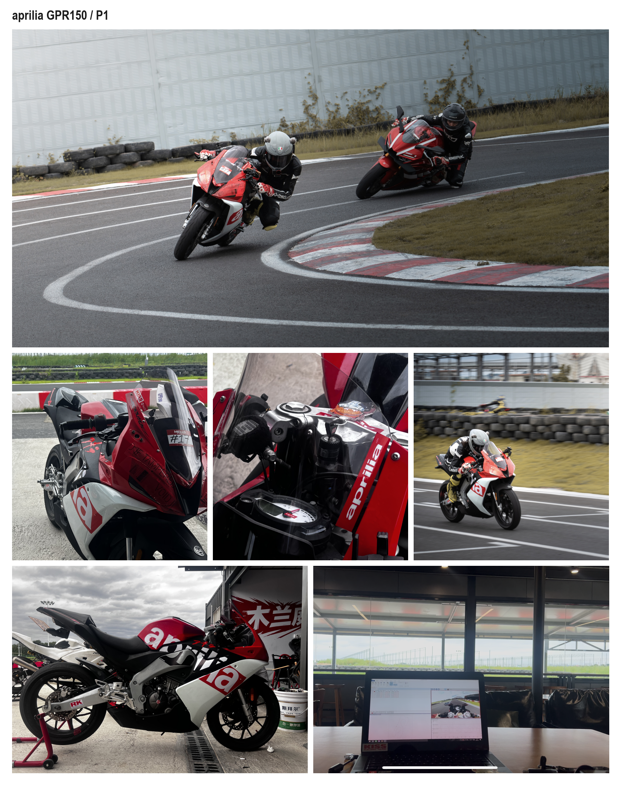

# 赛车数据分析与车辆工程作品集

[English](README.md) · 中文

我是香港中文大学（深圳）的计算机科学学生，自己骑车、采数据、做分析，也参加模拟赛车练习和比赛。我编写遥测分析工具，以及车辆动力学和圈速模型。

以下项目包括线路、刹车和油门对比，比赛时间损失、设定测试，以及车辆和圈速计算。

## 项目入口

1. **[aprilia GPR150 / P1 实车数据分析](zh/aprilia-gpr150-p1.md)**：九节练习、71 个计时圈；刹车点逐步后移的过程、开油时机、连续弯线路和分段时间差。
2. **[GPR150 / 速搏：连续弯收益与心率位置规律](zh/subo-gpr150.md)**：比较两组同节连续弯的时间差，并叠加整圈心率，检查不同节里反复出现的下降位置。
3. **[模拟赛车分析与测试](zh/sim-racing.md)**：MX-5、F4、GT1；对齐回放和遥测，分析轮载、抱死、比赛时间损失和设定测试。
4. **[车辆动力学与最小圈速建模](zh/vehicle-modelling.md)**：CBR650R 的台架曲线、车辆参数、赛道形状、抓地力假设、线路与速度计算。
5. **[CBR650R / 化龙练习分析](zh/hualong-cbr650r.md)**：最好圈提高 5.228 s；比较整节油门使用和目标弯的反复收油，附 OBD 曲线及车载画面。
6. **[实车采集与现场工作流](case_studies/data-acquisition-workflow.md)**：RaceChrono、GPS／IMU／胸部心率带、BLE OBD、头盔影像和 Circuit Tools 3。英文说明。

## 我能为车队做什么

| 车队任务 | 已有工作证据（Evidence from the work） |
|---|---|
| 整理每节的数据 | [实车采集工作流](case_studies/data-acquisition-workflow.md)：记录 GPS、IMU、OBD 和视频，检查时间是否对齐、定位是否可靠、每圈是否正确划分；[模拟赛车分析](zh/sim-racing.md)：整合回放与遥测，恢复缺失通道。 |
| 找出时间损失 | [GPR150 / P1](zh/aprilia-gpr150-p1.md)：用固定赛道位置划分区段，比较连续弯哪里变快、哪里变慢；[MX-5 / Lime Rock](case_studies/lime-rock-mx5-race-analysis.md)：S1 占排位差距的 60.5%，七个较慢圈合计损失 28.50 s。 |
| 将车辆数据转成测试方案 | [F4 / Paul Ricard](case_studies/paul-ricard-f4-development.md)：对照刹车释放、出弯速度与后轮轮载；[GT1 / Silverstone](case_studies/silverstone-gt1-sim.md)：定位前轮抱死区间，提出将前刹车配比从 61% 改为 60.5%，保持其他设定不变的测试。 |
| 复盘圈速稳定性 | [GPR150 / P1](zh/aprilia-gpr150-p1.md)：九节练习、71 个计时圈，比较刹车点的变化和连续圈表现；[三场模拟比赛](case_studies/paul-ricard-race-consistency.md)：比较正常圈的圈速波动，并把损伤、切弯和事故后的时间损失列出来。 |
| 支持实车采集与节间复盘 | [采集与现场工作流](case_studies/data-acquisition-workflow.md)：RaceChrono、GPS／IMU／胸部心率带、vLinker MC+ BLE OBD、Action 5 Pro 头盔影像与多机位对齐；休息期间在 P 房用 Circuit Tools 3 复盘并制定下一节计划。 |
| 开发模型与分析工具 | [CBR650R / P1 建模](zh/vehicle-modelling.md)：结合实测数据、台架曲线、传动比和赛道形状，在不同抓地力假设下计算线路、速度和挡位；提供[可运行的圈速计算代码](modelling/code/README.md)。 |

[使用的工具与开发工作](TECHNICAL_PROFILE.md) · [节间复盘与练习记录](TRACKSIDE_FEEDBACK_LOOP.md) · [工程工作概览](PORTFOLIO.md)

各项目附有详细分析、方法说明、结果数据或代码链接。
