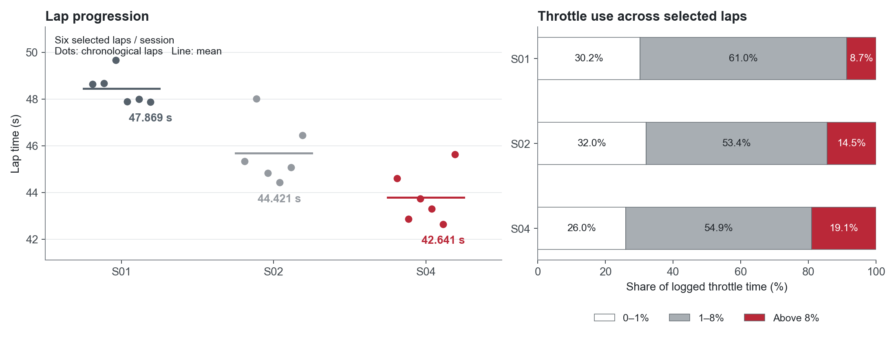
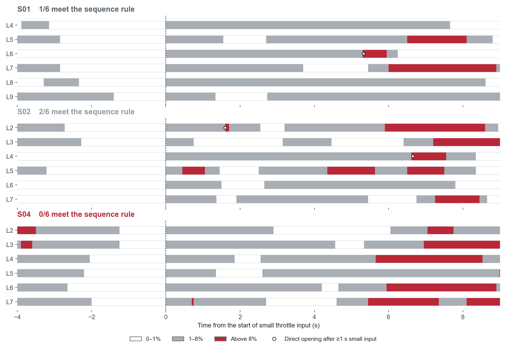
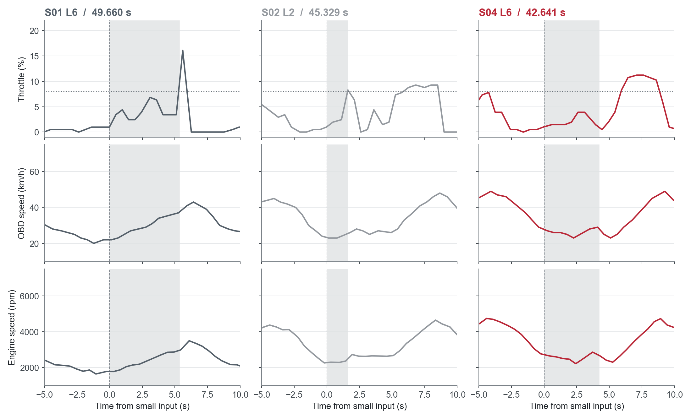
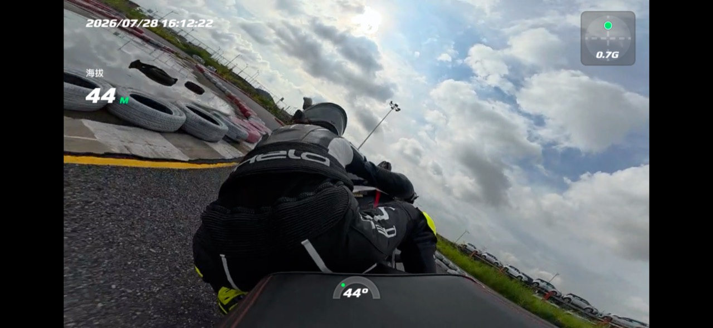
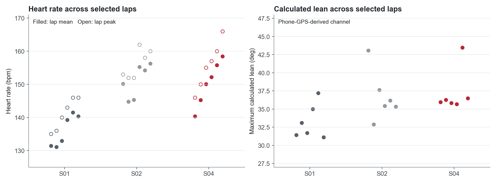

# CBR650R / Hualong: lap progression and corner-exit control

[Portfolio contents](../README.md) · [中文](../zh/hualong-cbr650r.md) · [Methods and source notes](hualong-cbr650r-methods.md)

**28 July 2026 · 2020 Honda CBR650R · four practice sessions**

I rode four sessions at Hualong in Guangzhou on Michelin Road 6 tyres, recording RaceChrono, OBD, heart rate and onboard footage. I selected comparable laps, checked the throttle calibration and compared the opening sequence through one target corner.

The selected best laps improved **47.869 → 44.421 → 42.641 s**. I then checked whether the faster laps also repeated the day's target: small throttle input followed by continuous exit drive.

## Session progression: pace and throttle use

I retained six laps each from S01, S02 and S04 after removing out-laps, in-laps and cooldown running. Their mean lap times moved **48.454 → 45.688 → 43.792 s**, alongside the **5.228 s** best-lap improvement.

I scaled OBD throttle to 0–100% using the recorded closed/open endpoints, then weighted each available reading by its elapsed duration. Time above **8%** increased **8.7% → 14.5% → 19.1%** across the selected laps. Both the best lap and the six-lap mean improved as more time was spent above this throttle threshold.

S03's automatic timing merged laps during GPS degradation. I retained its provisional **44.412 s** record in the source notes and excluded it from these comparisons.

## Target corner: opening once or opening repeatedly

I divided throttle into three states: **0–1%**, **1–8%** and **above 8%**. In the selected target-corner window, I looked for a closed phase followed by at least one second of small input and then an opening above 8%. The original rule matched **1/6 S01 laps, 2/6 S02 laps and 0/6 S04 laps**.

Each strip starts its clock at the first small input in the selected sequence. White is near-closed throttle, grey is small input and red is above 8%. Circles mark the first opening that meets the original rule. The strips expose repeated closures and delayed openings within each session.

I followed the flags back to the continuous traces. **S02 L2 meets the threshold rule, then closes again almost immediately.** Its first opening therefore still needs to be read alongside the following speed and RPM response.

## Three attempts: throttle, speed and RPM together

The columns show **S01 L6**, **S02 L2** and **S04 L6**, aligned at the start of small throttle input. The shaded area covers that first small-input phase; the dotted line is 8% throttle. I selected the first two because they match the original rule, and the third because it is the day's PB.

- **S01 L6 / 49.660 s:** the closed phase lasts **6.081 s**, followed by **5.321 s** of small input. Speed and RPM recover gradually; the opening above 8% is followed by another closure.
- **S02 L2 / 45.329 s:** the closed phase is **2.735 s**, with **1.600 s** of small input. It crosses 8% briefly, closes, then builds another opening later in the passage.
- **S04 L6 / 42.641 s:** the closed phase is **2.650 s**, followed by **4.200 s** of small input and another closure. Speed and RPM dip again before the later opening.

The final session improved overall pace, while the target corner still contained repeated closures. My follow-up focus was the sequence through the corner: reduce the waiting phase and carry the opening into exit acceleration. I used the full trace, alongside the threshold flags, to choose that focus.

## Onboard context, lean and heart rate

*Saved S02 rear-facing onboard frame. Its overlay displays 44°; the session's maximum RaceChrono-calculated lean is 43.1°. This frame shows the riding position and compact track setting.*

I kept lap mean/peak heart rate and calculated lean alongside the lap and control comparisons. The selected-lap mean heart rates were approximately **136.0 / 150.9 / 150.3 bpm** in S01/S02/S04. The maximum calculated lean moved **37.2° → 43.1° → 43.5°**. S02 and S04 reached similar peaks while lap time continued to improve; the OBD traces show the changes in opening and speed recovery.

I reported low grip and rear-wheel movement in my riding notes. Those observations remain part of the session context. The graphs use the logged heart-rate and calculated-lean channels.

## Analysis and source material

I matched lap selections and target-event durations back to the original CSVs and analysis workbook, reproduced the **1/6, 2/6, 0/6** counts, and generated the comparisons above. The public evidence contains relative-time channel excerpts and per-lap summaries.

[Lap and event results](../assets/hualong/hualong-analysis-summary.json) · [Selected OBD trace excerpts](../assets/hualong/hualong-selected-traces.json) · [Definitions and source notes](hualong-cbr650r-methods.md) · [Acquisition workflow](data-acquisition-workflow.md)
