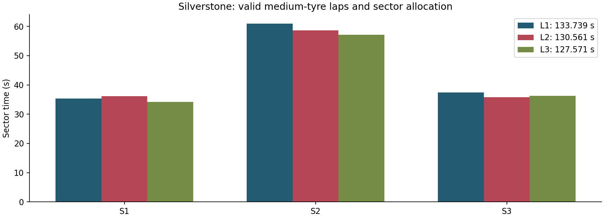
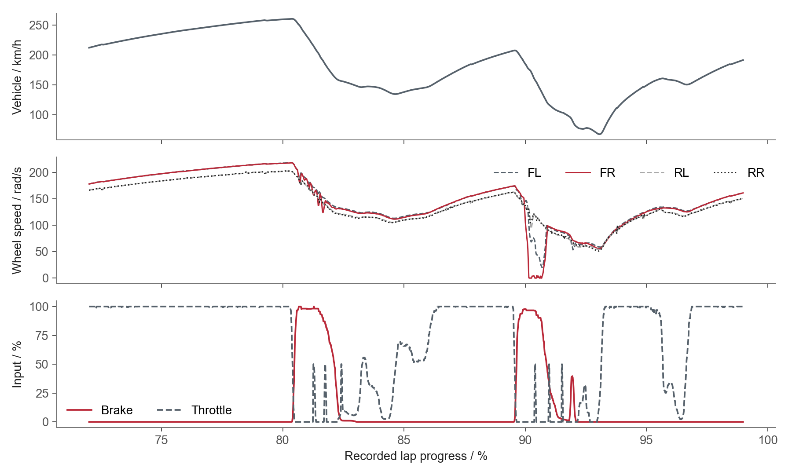

# GT1 / Silverstone: time-loss allocation, tyre state and controlled testing

[Portfolio contents](../README.md)

**2026-09-12 · Assetto Corsa · RSS GT Shadow V8 · Silverstone GP OSRW**

I drove and analysed a prequalification practice programme, combining CM laps and validity flags, the saved setup and **50 Hz Live Telemetry**. The work covers driving performance, brake/tyre behaviour and the next setup test.

## Valid laps and sector allocation

Three valid medium-tyre laps progress from **133.739 to 130.561 to 127.571 s**:

| Lap | S1 | S2 | S3 | Total |
|---|---:|---:|---:|---:|
| 1, medium | 35.374 s | 60.984 s | 37.381 s | 133.739 s |
| 2, medium | 36.142 s | 58.630 s | 35.789 s | 130.561 s |
| 3, medium | 34.156 s | 57.181 s | 36.234 s | 127.571 s |

The medium-only best-sector composite is **127.126 s**, just 0.445 s below the best completed valid lap. The subsequent soft-tyre laps are invalid: their best S2 is 56.515 s, but none converts that sector gain into a valid faster lap.

## Where the gain was made and returned

Comparing the final valid lap with the previous one:

| Measure | 130.561 s lap | 127.571 s lap |
|---|---:|---:|
| Average speed | 160.2 km/h | 163.8 km/h |
| Maximum speed | 260.4 km/h | 260.6 km/h |
| Full-throttle time | 58.3 s | 66.1 s |
| Brake-active time | 18.2 s | 17.6 s |
| Coasting time | 10.8 s | 11.0 s |

At approximately 60% track progress, the final lap was already 3.616 s ahead; the remaining section returned about 0.631 s. The largest gains were around Village/Loop/Aintree, Brooklands/Luffield and Copse. Copse-window minimum speed increased from about 144.7 to 152.1 km/h.

The almost unchanged maximum speed directs attention to corner execution and throttle connection.

## Brake and wheel-speed interpretation

The wheel-speed/brake traces show front-wheel lockup signals around Village, Becketts and Vale, especially at the right front. The inspected baseline has no ABS, 61% front brake bias and 100% configured brake power.

On the **2:07.571 medium-tyre lap**, the right-front angular speed falls below **5 rad/s** and reaches zero at **90.15–90.71% progress**. Vehicle speed remains **135–176 km/h**, brake input is **79–97%**, and both rear wheels continue rotating above 93 rad/s.

The proposed test changes front bias from **61.0% to 60.5%**, keeping medium tyres, 100% brake power and the other settings fixed. I will compare front-lockup duration, rear stability, brake release, exit speed and consecutive valid laps in the same zones.

## Tyre and compound management

With four cold pressures set to 20 psi, the end of the fastest medium lap records:

| Wheel | Hot pressure | Core temperature |
|---|---:|---:|
| LF | 28.22 psi | 80.8 C |
| RF | 27.88 psi | 78.5 C |
| LR | 28.96 psi | 85.7 C |
| RR | 28.08 psi | 79.9 C |

The later soft-tyre segment reaches about 29.82 psi and 91.4 C at the left rear. Combined with repeated S3 errors and invalid laps, this supports keeping a medium-tyre baseline until a comparable soft stint exists.

## Fuel, conditions and session identity

The CM record reports 49.904 km and 31.4 L consumed, equivalent to approximately **3.70 L per 5.891 km lap**. The final setup stores 18 L. Practice conditions were 26 C air / 34 C track; the event target was 18 C / 30 C.

A later capture carries a Silverstone/Shadow filename but matches a CM Macau/Evo session. It is excluded from this case because startup metadata was stale. Filename matching alone would have contaminated both the performance comparison and tyre conclusions.

See [aggregate evidence and source notes](../assets/sim/README.md).
