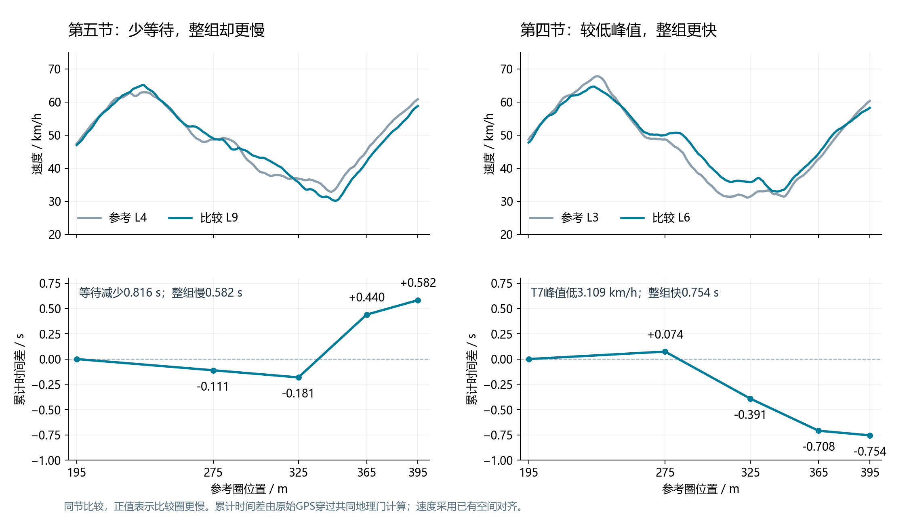
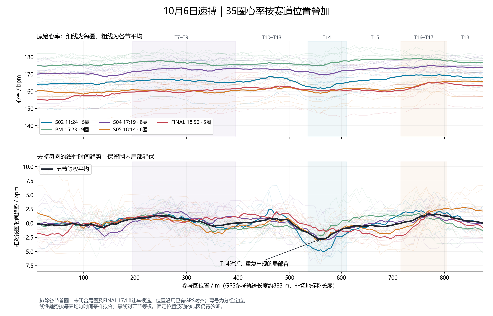

# GPR150 / Subo: linked-corner gains and spatial heart-rate patterns

[Portfolio contents](../README.md) · [中文](../zh/subo-gpr150.md)

**6 October 2026 · Subo, Guangzhou · Aprilia GPR150**

I rode, reported feedback and reviewed sessions at a new circuit. Best lap improved from 62.118 s in the morning to 60.741 s; fourteen afternoon/evening laps were below 61.6 s. The retrospective focused on T7–T9 time gains and repeated heart-rate changes at circuit locations.

**How this extends [P1](p1-gpr150-telemetry.md):** P1 joins lines, throttle and direction changes to explain linked-corner losses, and compares HR around selected deceleration events. Subo places two same-session outcomes side by side: less waiting but a slower package, versus a lower peak but a faster package. HR analysis starts with whole-lap scanning and identifies a pattern repeated across sessions.

## Linked corners: two outcomes from the same objective

**18:14, lap 9 against lap 4:** low-speed waiting before the T8 transition fell by 0.816 s. Lap 9 gained 0.181 s by the intermediate gate, then returned 0.762 s through T9 and downstream. The complete T7–T9 package was 0.582 s slower. Its later speed trace falls earlier and reaches a deeper T9 minimum.

**17:19, lap 6 against lap 3:** T7 peak speed was 3.109 km/h lower; low-speed waiting fell by 1.314 s and T9 minimum speed was 1.516 km/h higher. T8, T9 and downstream all contributed to a 0.754 s package gain.

The paired outcomes put acceptance at the complete-package exit. Reference laps retain the whole sequence, with cumulative time at the common exit determining whether a process change paid off.

There were also within-lap trade-offs: the 17:19 lap 6 tail lost 0.550 s while T7–T9 gained 0.754 s. The 18:14 lap 9 tail advantage survived to the straight's final study gate at 0.150 s. Different sections receive different reference laps.

## Whole-lap HR overlay: a repeated spatial trough

Across five sessions, raw HR fell in the T13-exit/T14 region in 33 of 35 retained laps, with a median local drop of approximately 1.7 bpm. After removing each lap's linear time trend, 34 laps showed a decrease. The pooled trough was near reference progress 560 m.

I reported smoother riding through the long T13 left-hander as a possible contributor to the later trough. Calculated lean stayed around −40° to −42° through the main phase; HR was already falling during the exit roll toward upright. The trough followed upright by a median of 3.0 s, with a middle-half range of 2.1–4.0 s.

Within-session movement of the upright crossing and trough was weakly associated; fixed-delay and fixed-position predictions both had typical timing errors of about 1.1 s. Smoother T13 riding and the exit loading change remain a working explanation. Physical and sensor mechanisms, and independent-day replication, remain open.

The spatial pattern was missed in the initial lap-average review and found after my question. Subsequent analyses now include complete-lap spatial overlays, repeatability and counterexamples for rider channels.

## Figure definitions

Split times use same-session raw GPS crossings of fixed geographical planes; speed uses the existing common progress axis. Positive differences mean the comparison lap is slower. The tail study ends at reference progress 875 m.

HR profiles exclude first laps, unclosed tails and final yielding candidates. The raw local comparison uses 500–520 m and 540–560 m windows. Linear trends are fitted by uniform within-lap time, and the pooled profile gives equal weight to five sessions. The relative path is approximately 883 m; the advertised circuit length is 1100 m. The spatial scan is an exploratory within-day result.

Subo had GPS speed, calculated lean and HR, with no OBD. Riding, feedback and corrections came from me; AI collaboration supported processing and figures. Full telemetry and messages remain local; [published results](../assets/subo/results.json) retain selected definitions.

[Fixed-gate method](p1-gpr150-methods.md#fixed-geographic-comparisons) · [P1 event-window HR](p1-gpr150-analysis.md#heart-rate-inspect-the-response-shape-against-the-session-pattern) · [Acquisition workflow](data-acquisition-workflow.md)
