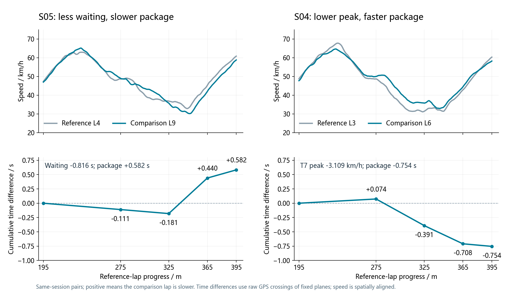
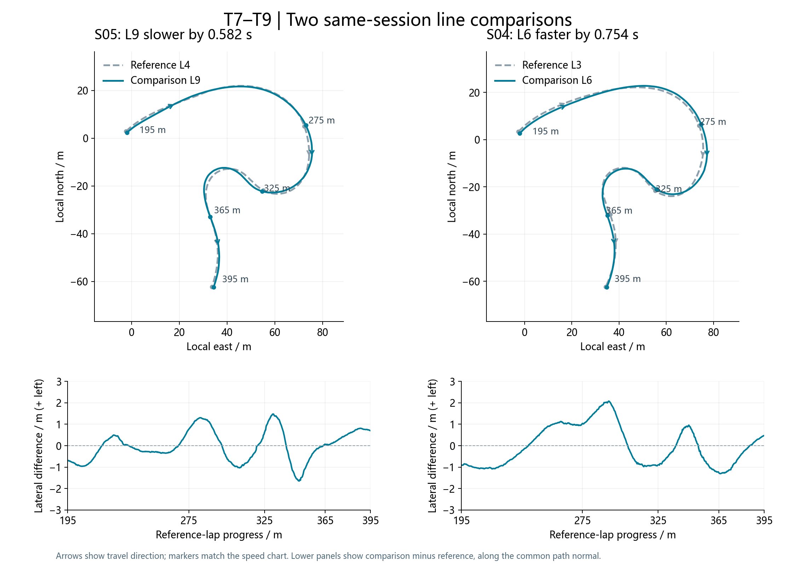
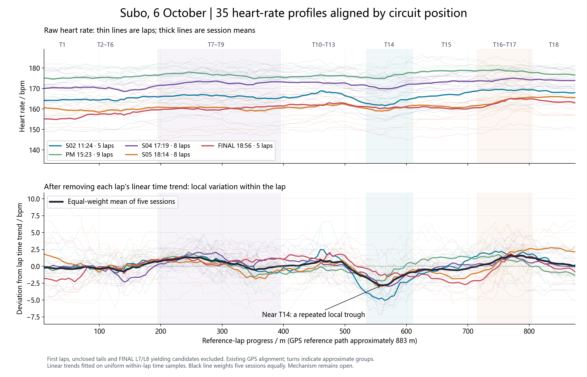

# GPR150 / Subo: linked-corner gains and spatial heart-rate patterns

[Portfolio contents](../README.md) · [中文](../zh/subo-gpr150.md)

**6 October 2026 · Subo, Guangzhou · aprilia GPR150**

I recorded my riding feedback and reviewed sessions at this new circuit. Best lap improved from 62.118 s in the morning to 60.741 s; fourteen afternoon/evening laps were below 61.6 s. I focused the post-session review on T7–T9 time gains and repeated heart-rate changes at circuit locations.

In [P1](p1-gpr150-telemetry.md), I compared lines, throttle and direction changes through linked corners, with HR windows around selected deceleration events. At Subo I compared two pairs from the same sessions and scanned whole-lap HR for patterns repeated across sessions.

## Linked corners: two outcomes from the same objective

**18:14, lap 9 against lap 4:** low-speed waiting before the T8 transition fell by 0.816 s. Lap 9 gained 0.181 s by the intermediate gate, then returned 0.762 s through T9 and downstream. The complete T7–T9 combined section was 0.582 s slower. Its later speed trace falls earlier and reaches a deeper T9 minimum.

**17:19, lap 6 against lap 3:** T7 peak speed was 3.109 km/h lower; low-speed waiting fell by 1.314 s and T9 minimum speed was 1.516 km/h higher. T8, T9 and downstream all contributed to a 0.754 s combined section gain.

The paired lines are close overall, with local lateral differences of roughly 1–2 m. At reference progress 300 m, S04 L6 is 5.6 km/h faster than L3, and S05 L9 is 3.5 km/h faster than L4. At 325 m, S04 still carries 4.4 km/h more speed, while S05 is already 1.0 km/h slower. The initial speed advantage survives T8-to-T9 in one pair and disappears in the other.

There were also within-lap trade-offs: the 17:19 lap 6 tail lost 0.550 s while T7–T9 gained 0.754 s. The 18:14 lap 9 tail advantage survived to the straight's final study gate at 0.150 s. Different sections receive different reference laps.

## Whole-lap HR overlay: a repeated spatial trough

Across five sessions, raw HR fell in the T13-exit/T14 region in 33 of 35 retained laps, with a median local drop of approximately 1.7 bpm. After removing each lap's linear time trend, 34 laps showed a decrease. The pooled trough was near reference progress 560 m.

I reported smoother riding through the long T13 left-hander as a possible contributor to the later trough. Calculated lean stayed around −40° to −42° through the main phase; HR was already falling during the exit roll toward upright. The trough followed upright by a median of 3.0 s, with an interquartile range of 2.1–4.0 s.

Within-session movement of the upright crossing and trough was weakly associated; fixed-delay and fixed-position predictions both had typical timing errors of about 1.1 s. Smoother T13 riding and the exit loading change remain a working explanation. The data do not distinguish a physiological response from a sensor effect.

[Fixed-gate method](p1-gpr150-methods.md#fixed-geographic-comparisons) · [P1 event-window HR](p1-gpr150-analysis.md#heart-rate-inspect-the-response-shape-against-the-session-pattern) · [Acquisition workflow](data-acquisition-workflow.md)
