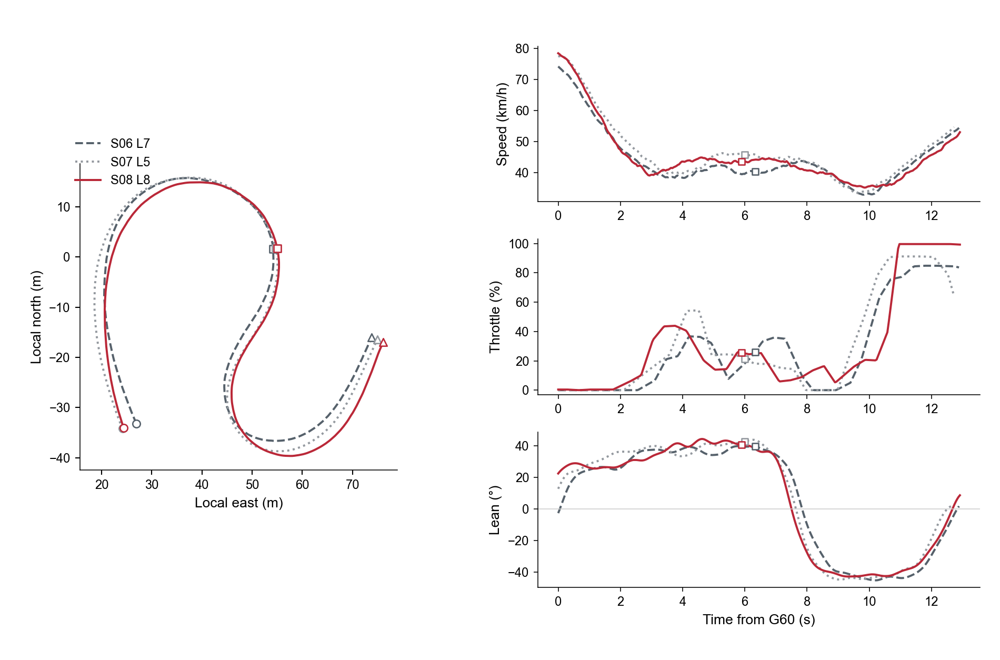

# 第 1 周｜P1 连续弯节间工程汇报

计划周：2026-10-19 至 2026-10-25（第 1 周）  
实际练习日期：2026-10-18（提前开始）  
项目：[赛车遥测与比赛工程长期实作计划](../../telemetry-race-engineering-long-term-plan.md)  
性质：基于既有实车作品集的模拟车手沟通练习；本次未新增赛道测试。  
状态：首轮回答及文本评估已完成；用户已认可修订后的示范稿。用户第二轮口述尚未提交；新增赛道测试未执行。

## 可展示交付摘要

- **问题**：车手认为连续弯前段更快，询问下一节如何调整。
- **证据**：S06 L7→S08 L8，G60–G70 快 0.431 s，G70–G80 慢 0.461 s，完整 G60–G80 慢 0.030 s。已有线路、速度、油门、倾角对比。
- **首轮表现**：能够连接分段得失、提出线路假设、安排对比并说明不成立时继续检验；仍需压缩重复、明确比较对象、限制因果推断、固定事件定义与测试变量。
- **下一轮验收**：目标 60 秒左右；准确命名比较圈与地理区段；只保留一个原因假设和一个操作变量；说明完整区段评价及重复圈检验。没有音频时不以字数反推是否达成时长。
- **交付内容**：原始转写、证据核对、评价表、修改示例与下一节测试记录草案。修改示例由助手编写，不作为用户已经达到的表达表现。

## 1. 情景与核对材料

模拟车手问题：“我前面明明更快，下一节应该怎么跑？”

材料：
- [P1 连续弯案例](../../../case_studies/p1-gpr150-analysis.md#1-linked-sequence-a-quicker-right-hand-block-can-cost-the-next-transition)
- [固定地理门及测量方法](../../../case_studies/p1-gpr150-methods.md)
- [分段时间与门速度汇总](../../../assets/p1/p1-development-detail-summary.json)

本次核对已查看上图与案例文字。右侧横轴是 Time from G60；方块标记各圈 G70，通过时间不同。左侧轨迹使用共同地理坐标。案例明确说明相同经过时间未必对应相同位置。

用户口述采用 T11–T14 识别弯道。正式数据记录仍以 G60–G70／G70–G80 为准；T 编号与门边界的具体映射需对照赛道板核实，不能直接把每个计时门等同于某个弯顶。

## 2. 第一轮原始转写

以下逐字保留本次收到的文本，不修正口误或识别错误：

> 喂，对，车手，你的感觉是对的。你在第一段，这个连续弯第一段里面T11到T12和T13这个右手弯，你确实比之前的 session 要更快，快0.43秒左右。但是你在左手弯这个翻身弯和这个掉头弯T14的时候，慢了0.461秒，所以你总共慢了0.03秒。然后在你的表现上面我们发现，你后面的那个跑法让你不得不更早地去向左倾斜，因为你的前面T11、T12、T13的速度，带的速度要比你之前跑的要更快，所以你在T13的时候很难向右完全用尽右边的赛道宽度然后再向左倾斜到T14。也就是说，你更早地左倾了。然后这样的话你在T14这个掉头弯，这里就不得不去走一个抛大路线。也就是我们后面也观察到你非常容易在后面的 session 里面在T14的右侧出弯的路肩那里上草。我们也观察到你后面的跑法就更早地左倾，导致你不得不去更晚开油。我们这边观察到你开油时间点比之前慢了大概整整一秒左右，整整一秒左右。之前是在9秒的时候开油，然后现在的话是在10.5秒，10.05秒，10.5秒的时候开油左右，其实慢了大概有一点多秒。我们这边预估是这样。我现在最怀疑的就是你的线路选择，可能因为后面T14的出弯速度，因为你更晚开油而降低太多，所以损失更多时间。所以我们，但它还需要验证，所以你应该再去试着跑一次原本的那种跑法，也就是在T11、T12、T13这个常的右手弯这里降低更多速度，然后在T13进T14的时候向右倾更多，更晚地入弯然后更早开油去用尽这个赛道空间。我们要通过一次这样的测试去验证是不是线路问题。然后回来的话我们看你是不是跟之前的B测试相比，也就是你早左倾然后晚开油这个测试相比，你在前半段的时间是不是要更多一点，但是能够使我们T14的出弯速度更快，而且整体得到更多的时间。如果不是这样的话，那我们就再提出新的假设。

收到的输入为转写文本，未获得可独立核对的音频。因此不评价实际语速、时长、停顿、音量、声线或情绪稳定程度。转写中的“常的右手弯”“10.5／10.05／10.5”等保留原样；数字意图需本人确认，不据此认定口头表达一定发生了反复修正。

## 3. 证据核对与工程判断

| 原回答中的内容 | 核对结果 | 更可靠的说法／处理 |
|---|---|---|
| 前段快约 0.43 s、后段慢 0.461 s、总计慢 0.03 s | 与 S06 L7→S08 L8 固定门结果一致 | 口头可统一为“前段快约四成三，后段丢约四成六，整个弯组基本持平”；报告保留完整数值 |
| “比之前的 session”／“后面的跑法”／“B测试” | 比较对象指代不够明确；历史两圈不是已执行的受控 A/B 实验 | 先报 S06 L7 与 S08 L8；仅在新测试中给 A、B 编号 |
| 更早向左倾斜 | 图支持红线在 G60 起算的时间轴上更早左倾 | 不能由此直接推出地理位置更早换向；需将倾角过零事件映射到轨迹位置，必要时看视频 |
| 前段速度快使其“不得不”早左倾，继而线路抛大、晚开油 | 图中速度、姿态和线路存在差异，但该因果链尚未证实 | 在原因解释开始时就说“我怀疑”；不能先用“不得不／导致”讲成事实，再只在结尾补“待验证” |
| 后续 session 经常上草 | 本次回答新增的本人经验／回忆，选定图表未验证频次和发生圈 | 保留为车手线索，后续记录对应 session/lap、视频时间戳及次数后再作为证据 |
| 开油从约 9 s 变为 10.05／10.5 s，晚一秒多 | 数字意图待澄清；图中约 9 s 已存在非零油门，不能不加定义就称为“第一次开油” | 明确比较圈、原始／归一化油门、阈值、持续时长、搜索区间；区分首次非零、持续接油与大油门建立，粗略读图不报成精确差值 |
| 前段快、后段损失更多 | 选定两圈的得失支持这一描述 | 0.030 s 净差本身不足以判定一种跑法稳定更慢；下一步比较多个可比圈的完整弯组时间与波动 |
| 恢复前段减速、增加右倾、晚入弯、早开油、用尽宽度 | 测试意图明确，但一次包含多个变化，难以归因 | 首次只改变一个可执行变量，其余作为观察指标；倾角大小不能直接代替线路位置 |
| 若结果不支持就提出新假设 | 已有可证伪意识 | 单次失败先检查车手是否执行到位、条件和数据是否可比，再判断假设需要修改还是暂不成立 |

## 4. 首轮文本评价

评价为本次练习的定性反馈，不是职业资格评分。每项附具体文本依据，不给缺乏比较基准的总分。

| 评估项 | 本轮判断 | 文本依据与下一步 |
|---|---|---|
| 简短 | 需要压缩 | “更早左倾”和“整整一秒左右”重复；中间的线路解释占据较多篇幅。保留一次事实、一次假设、一次操作、一次验收 |
| Precise／精确 | 分段数字准确；对象与事件定义需补 | 开头收益回加正确；“之前／后面／B测试”需替换为圈号，开油需要可复现定义 |
| 信息量 | 有效内容多，但重复和未验证机制稀释密度 | 已覆盖时间损失、车辆行为、原因假设、下一节操作与验收；减少同义解释和未经核对的机制细节 |
| 判断分寸 | 有验证意识；因果语气需提前收紧 | 有“最怀疑”“还需要验证”；前半却用“不得不”“导致”确定机制 |
| 冷静与协作（措辞） | 有合作式开场；语气强度可降低 | “你的感觉是对的”先承认前段收益，未责备车手；“整整”“不得不”可改为中性描述。声线冷静度未评估 |
| 可执行性 | 有方向，尚未形成单变量任务 | 车手能知道想改线路，但同时被要求减速、增倾、晚入弯和早开油；需要缩成一个明确操作 |
| 验证闭环 | 结构已具备，判定需更稳健 | 看前后段、出弯速度和全段收益是正确方向；增加执行检查、重复圈与条件记录，避免一圈成功／失败就定论 |

## 5. 首版助手修改示例（已被用户反馈取代）

用户随后指出这版过于机械、防御性强，缺少能让车手确定执行的指导。保留它用于记录修订过程，不再作为本周推荐口述版本。

下面是压缩结构示例，不代填未经验证的开油秒数、地理换向位置或路肩事件：

> 你前段确实快了。S08 L8 比 S06 L7 在 G60–G70 快约 0.43 秒，但下一段丢回约 0.46 秒，整个弯组基本持平。线路和换向过程也有变化，我怀疑前段提速改变了后一个左弯的准备，但原因还没确认。下一节先只测试把前段速度恢复到 S06 的参考范围，其他操作先不额外要求改变；出车前我们在图上确认比较位置。回来检查你有没有达到这个输入，再比较完整 G60–G80 的多圈时间、G80 速度和持续开油位置，看是否出现稳定收益。

这是供第二轮演练使用的候选方案。选定参考位置与速度范围、明确油门事件定义后，才形成可直接执行的正式 run sheet。车手若无法稳定复现指定输入，应先调整任务，而非直接判定线路假设失败。

## 6. 下一节测试记录草案

| 项目 | 待执行安排 |
|---|---|
| 测试问题 | 降低前段速度是否改善后段准备，并使完整弯组表现更好？ |
| A／B 定义 | A 为当前可重复基线；B 只改变一个选定位置的前段速度目标。历史 S06／S08 为参考，不是新实验的受控 A／B 结果 |
| 出车前须确定 | 图上标记速度检查位置、参考范围和车手使用的实际参照；核对门与 T 编号映射；定义持续开油事件；不凭此图编造具体刹车标志 |
| 保持／记录条件 | 车辆设定、轮胎与胎压、运行阶段、交通及环境；记录变化，避免将受干扰圈硬凑成可比样本 |
| 执行检查 | 先看 B 是否达到指定输入；若未达到，不将其当作对假设的有效检验 |
| 主要结果 | 完整 G60–G80 时间及多个有效圈的分布；前后两段时间分别保留 |
| 辅助解释 | G80 固定位置速度、线路与换向的地理位置、按统一规则检测的持续开油位置和时刻 |
| 判定 | 比较收益与当次基线波动及测量限制；存在可重复净收益再保留，无清楚差异则暂不下结论 |
| 当前状态 | 模拟方案草案；未出车、未执行、无新增测试结果 |

## 7. 待澄清与第二轮目标

1. 原口述的后段开油时间最终是 10.05 s 还是 10.5 s？“开油”指哪类事件，所比两条线是哪两圈？待本人核实，暂不采用秒数。
2. “后续 session 容易上草”作为本人经验保留；若用于展示因果证据，需补发生圈与视频依据。
3. 第二轮在约 60 秒目标内，只讲“比较对象与得失 → 一个假设 → 一个操作 → 如何检查”。文本输入无法验证真实时长。
4. 本记录不把助手修改稿当作用户已完成第二轮，不把模拟方案当作实车测试完成。

第二轮与后续澄清追加于此，保留首轮原文及修订过程。

## 8. 用户反馈与确认的沟通方向

用户反馈：首版助手示范“太人机”，分析无法给车手确定的东西，过于保守、防御；随后明确认可下列修订稿。

本周采用的改进原则：

- 工程师先消化数据和不确定性，再给车手明确的判断、优先级和下一节操作。
- 对拟采用的测试方向作决定，承担跟踪与复盘责任；不把真实因果尚未验证说成没有任何可执行方向。
- 车手汇报中保留必要的判断分寸，但不反复插入免责声明；详细定义、误差和判断条件放在工程记录里。
- 原回答的主要修改点是重复和指令过多，不是取消线路判断。
- “一个测试方向”可以包含相互配合的驾驶动作；若多个动作同时变化，应明确这是整体跑法对比，结果不能单独归因于某个动作。不要机械地为了单变量而把车手指令变得不可用。

### 用户已认可的示范稿

下文由助手编写，用户认可其风格及练习方向；不代表用户已完成第二轮口述，也不代表线路机制已被实车验证。

> 对，前面你确实快了四成多，但后面又全丢回来了。这一节我们先解决后面那个掉头弯。
>
> 我的判断是，你前面赶得太急，接左弯的时候位置没准备好，后面就一直在等开油。
>
> 下一节先别抢前面这四成。右弯收一点，把接左弯的位置留出来。重点就一个：把后面这个弯的出口做好，不用追整圈。
>
> 回来我看整个弯组的时间，再看出口速度和开油。前面让掉一点没关系，我要看后面能不能赚得更多。这个方向我来盯，你先跑出几圈能重复的。

“我的判断”表示本次选定要检验的工程方向；“位置没准备好／等开油”是工作假设。原始图表能确定的时间得失和本次选择的解释仍分别保留在第 3 节。现场示范不需要逐句重复这些备注。

## 9. 本周归档与下一步

- 已完成：材料选定、第一轮用户转写、图文核对、逐项评价、用户反馈、示范修订与认可。
- 待完成：用已认可风格进行第二轮口述；必要的数字澄清；形成最终展示摘要。新增实车测试另行记录，不能与沟通练习混为一项已执行测试。
- 本周后续内容继续追加在此文件或同目录；如产生报告、run sheet、图表或可用音频，可放在同一周文件夹，并在本文件链接。
- 长期计划只保留路线、能力基线和每周索引，不承载完整练习过程。
