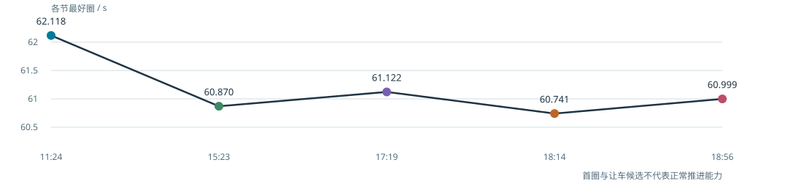
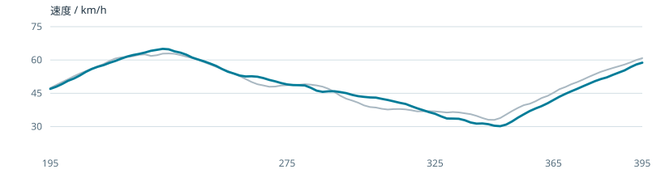
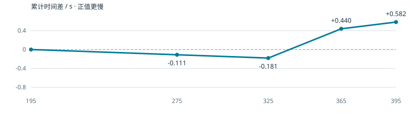
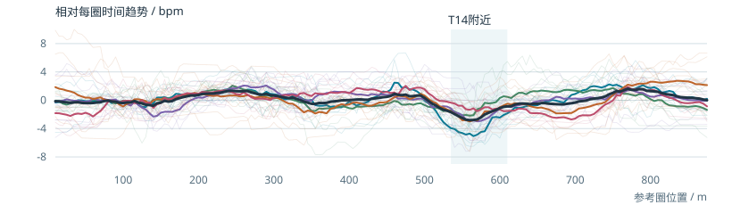

# GPR150 / 速搏：人与车进入一条新赛道

[交互案例页](../previews/subo/index.html) · [六页视觉报告](../assets/subo/subo-case-study.pdf) · [English](../case_studies/subo-gpr150.md)

2026年10月6日，广州速搏。我驾驶Aprilia GPR150，同时采集数据、报告反馈并参与节间分析。研究围绕T7–T9连续弯、T15与尾弯，以及人的适应过程展开。AI协作参与数据处理、图表与复盘；问题提出、驾驶执行、现场反馈及纠正来自驾驶员。

## 从适应到可重复的速度

上午最好62.118秒，全天最好60.741秒，改善1.377秒。下午至晚间14圈低于61.6秒；17:19一节的三个最快圈仅差0.326秒。成果是建立可重复的速度，而不只是一个PB。

暖胎包条件下1.70 / 1.60 bar热态读数反复稳定，形成当日工作基线。最优胎压与滑动的因果关系仍未确认。

## 连续弯：过程指标改善，不保证整组更快

第五节L9相对L4，翻身前低速等待减少0.816秒。到参考325米已快0.181秒；随后T9与下游丢掉0.762秒，整组最终慢0.582秒。

第四节出现相反结果：L6相对L3，T7峰值低3.109 km/h，却在T7–T9整组快0.754秒。同圈尾部又慢0.550秒。由此将验收从单一恢复速度或等待时长，改为完整弯组及下游收益。

尾部另有有效样本：第五节L9相对L4，从T15到主直道末端仍快0.150秒。它适合作尾弯候选，而不应把整圈当万能参考。最左侧入口的原A/B身份未确认，不能把收益直接归因于绝对入口位置。

## 心率：按位置叠加后出现重复结构

T13末段到T14附近，原始心率局部窗口33/35圈下降，中位约1.7 bpm；五节均出现。去每圈线性时间趋势后34圈下降，合并曲线谷约在参考进度560米。

驾驶员解释是T13长左弯较顺畅，负荷变化的心率响应随后落在T14。谷比回到直立晚约3秒，但扶正位置与谷位置的移动关系较弱，固定延迟机制尚未确认。保留为工作解释，身体与传感器影响、跨日复现继续开放。

这一发现由驾驶员追问后才被分析。后续新赛道研究将人的通道位置叠加列为固定项目，同时覆盖时间过程、位置结构和圈序变化。

## 车队任务与已有工作证据

|车队任务|已有工作证据（Evidence from the work）|
|---|---|
|定位时间损失|固定地理门比较同节圈，追踪上游0.181秒收益如何被下游抵消。|
|判断出口策略|将尾部比较延伸至主直道末端，确认0.150秒仍被保留。|
|结合人和车辆|逐圈及逐位置分析心率，区分重复结构与疲劳/被追情境。|
|维护假设与试验|保留原话、执行身份、反例及结论状态，整组收益负责验收。|
|纠正误判|撤回受跨节共同位置项影响的T9“慢0.6秒”判断，避免据此错误指导。|

## 证据口径

- RaceChrono CSV/VBO来自本地原始档案；首节未记录。心率研究为五节35圈，排除首圈、未闭合尾段及最后让车候选。
- 速度及倾角为GPS与其计算通道；速搏缺OBD，不能直接识别油门、制动输入或车身IMU姿态。
- 连续弯时间差来自同节原始GPS跨越共同地理门；速度曲线采用现有空间对齐。各组边界是研究门线，不是实测弯界。
- 心率局部下降比较参考500–520米与540–560米窗口。图中线性趋势按每圈均匀时间采样拟合；粗线按节平均，综合线五节等权。参考轴约883米，不等于标称1100米。
- 心率峰谷为全圈扫描后的探索性结果，尚未做独立日验证。图中下游计时止于参考875米，未推定跨下一圈T1收益。
- 最后一节有被追、疲劳、主动让车及低光背景；不以单一原因解释退化。原始GNSS、完整遥测与私人记录留在本地，仅提供筛选衍生展示。

原始研究入口：本地速搏档案的DAY-RESEARCH、LINKED-CORNER-PAYOFF、HR-PARAMETER-RESEARCH、ORIGINAL-HYPOTHESES，以及2026-10-11的人车新赛道分析流程。交互页数据含相对轨迹与筛选曲线，时间收益计算不使用示意图校准。
